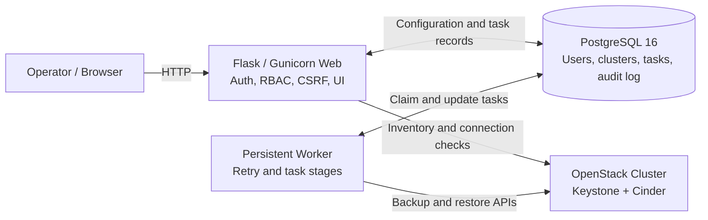
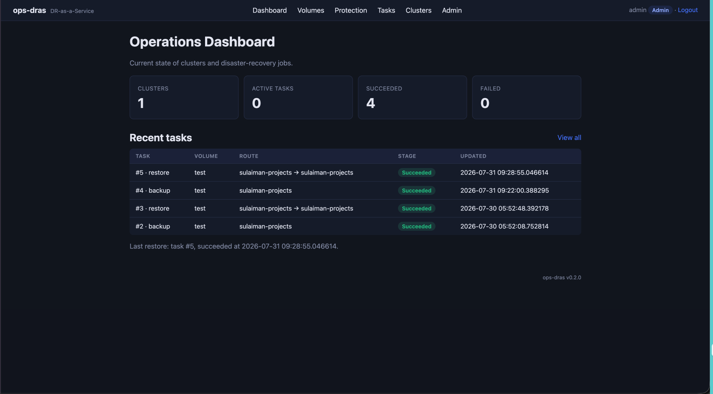

# ops-dras

OpenStack Disaster Recovery as a Service portal for orchestrating Cinder
volume backups and restores across one or more OpenStack clusters.

## High-level design

ops-dras separates interactive requests from long-running OpenStack
operations. The Flask web application validates access and stores a task in
PostgreSQL; a dedicated worker claims that task and calls Keystone/Cinder.



| Component | Responsibility |
| --- | --- |
| Web | Login, RBAC, CSRF, cluster configuration, inventory, task creation, and monitoring |
| PostgreSQL | Persistent users, encrypted cluster configuration, task queue, and audit history |
| Worker | Claims queued jobs, executes backup/restore stages, retries transient failures, and records results |
| OpenStack | Keystone authentication and Cinder volume/backup operations |

## About the application

ops-dras provides:

- Multi-cluster OpenStack configuration with password or Application Credential authentication.
- Native Cinder volume inventory and quick backup actions.
- Full, Incremental, and Automatic backup modes.
- Same-cluster and cross-cluster volume restore.
- Protection workflow for creating backups and restoring verified recovery points.
- Tasks workflow for queue progress, errors, cancellation, and history.
- Encrypted cluster secrets, RBAC, CSRF protection, audit logging, retry, and idempotency.

Cross-cluster restore transfers backup metadata, not backup payload data. The
source and destination Cinder services must access a compatible or shared
backup backend.

### Operations dashboard

The dashboard summarizes registered clusters, active tasks, successful and
failed operations, and recent backup/restore activity.



## Requirements

| | Minimum | Recommended |
| --- | --- | --- |
| vCPU | 2 | 4 |
| RAM | 2 GB | 4 GB |
| Disk | 10 GB free | 20 GB+ |
| OS | Linux with Docker Engine 24+ | same |
| Architecture | amd64 or arm64 | same |
| Network | Outbound HTTPS to Keystone/Cinder; inbound port `8080` or TLS proxy | Restrict inbound CIDRs and use HTTPS |

OpenStack clusters must be reachable and have Cinder Backup enabled. For
cross-cluster restore, both clusters must access compatible backup storage.
The configured OpenStack user or Application Credential needs volume and
backup permissions.

## Quick start

```bash
git clone git@github.com:sulaimantok/ops-dras.git
cd ops-dras
cp .env.example .env
```

Set at least `SECRET_KEY`, `DEFAULT_ADMIN_PASSWORD`,
`CLUSTER_CREDENTIALS_KEY`, and `POSTGRES_PASSWORD` in `.env`. OpenStack
credentials are entered later from the Clusters page.

```bash
docker compose up --build
```

Open `http://localhost:8080`, sign in with the configured admin credentials,
then:

1. Add OpenStack clusters from **Clusters**.
2. Use **Protection** to create backups or restore recovery points.
3. Use **Volumes** for inventory and native quick actions.
4. Use **Tasks** to monitor operations.

The application runs `alembic upgrade head` before Gunicorn starts.

## Documentation

- [Operations and Protection](docs/operations.md)
- [Deployment and Operations](docs/deployment.md)
- [Versioning and Releases](docs/releases.md)
- [Repository Structure](docs/repository-structure.md)
- [Contribution Guide](docs/CONTRIBUTING.md)

Runtime data such as `.env`, PostgreSQL backups, local databases, caches, and
OpenTofu deployment state are intentionally excluded from the repository.
