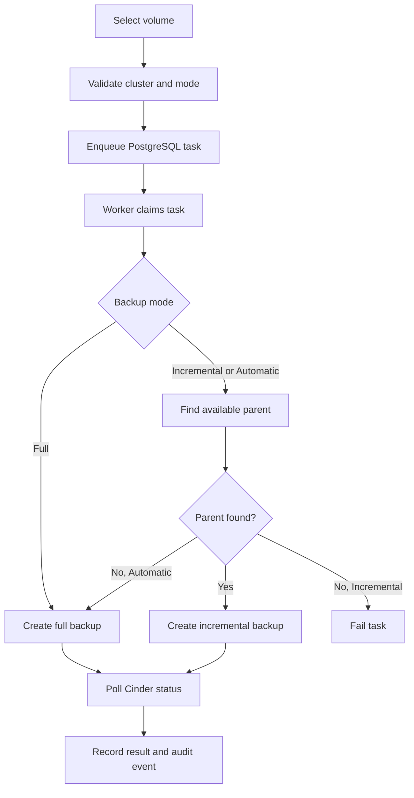
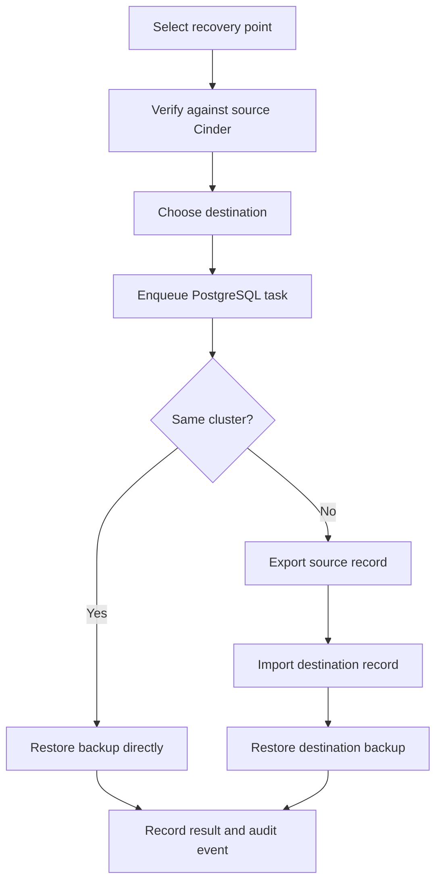

# Operations and Protection

## UI responsibilities

```text
Volumes     Cinder inventory and native quick backup action
Protection Create backups and restore verified recovery points
Tasks       Queue progress, results, errors, cancellation, and history
```

Protection supports Full, Incremental, and Automatic backup modes. Recovery
points are checked against `GET /backups/{backup_id}` in source Cinder whenever
the page loads. Backups deleted in OpenStack or no longer `available` are not
offered for restore, while their local task history remains visible in Tasks.

## Backup and restore details

Detailed Mermaid flows and the incremental backup behavior are documented in
the sections below. Cross-cluster restore transfers backup metadata, not
backup payload data; source and destination Cinder services must access a
compatible/shared backup backend.

### Backup flow



### Restore flow



### Protection at scale

- Volume search works by name or ID without a page reload.
- The volume table has bounded scrolling and a sticky header.
- Recovery points support search by volume name, volume ID, or backup ID.
- Recovery points support source-cluster filtering and pagination.

### Incremental backup behavior

- **Full** always requests a full Cinder backup.
- **Incremental** requires an `available` parent backup for the same volume;
  otherwise the task fails with `incremental_parent_missing`.
- **Automatic** uses incremental when a parent exists and falls back to full
  when it does not.

Task metadata includes `backup_mode`, `is_incremental`, and
`parent_backup_id`. Actual support depends on the configured Cinder backend.
