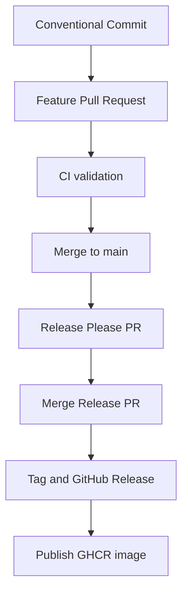

# Versioning and Releases

ops-dras uses Semantic Versioning and Conventional Commits. Release Please
updates `CHANGELOG.md`, `app/version.py`, and `.release-please-manifest.json`.

```text
fix: ...       PATCH
feat: ...      MINOR
feat!: ...     MAJOR
```

## Release flow



GitHub Release should contain a human-readable body generated from the
changelog. The `.tar.gz` and `.zip` source archives are generated automatically
by GitHub and do not replace release notes.

Normal Release Please operation requires workflow write permissions and the
repository setting that allows GitHub Actions to create Pull Requests.

Verification:

```bash
gh release view vX.Y.Z
gh run list --limit 10
git status --short --branch
```

See the [Contribution Guide](CONTRIBUTING.md)
for the complete contributor and maintainer workflow.
